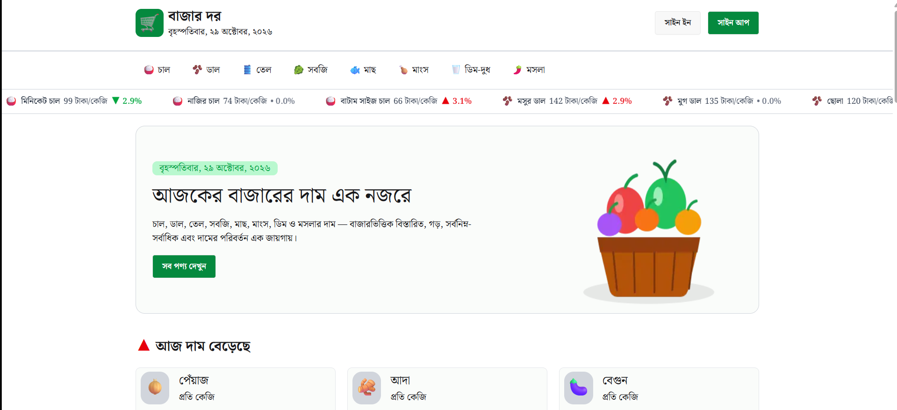

# 🛒 BazarDor — Daily Market Price Tracker

### 🇧🇩 Explore. Compare. Shop Smarter.

**BazarDor (বাজার দর)** is a modern, responsive web application designed to help people in Bangladesh explore essential product prices and compare market-wise pricing information. It provides an intuitive interface for browsing product categories, tracking price changes, and viewing detailed price comparisons.

🔗 **Live Demo:** [Visit BazarDor](https://bazar-dor-wheat.vercel.app/signUp)

---

## 📸 Project Screenshot

<!-- Add your project screenshot to the repository and update the path below. -->



---

## ✨ Key Features

- 📊 **Daily Price Tracking** — Explore product prices and price-change information.
- 📈 **Price Movement Insights** — Browse products with increasing and decreasing prices.
- 🛍️ **Category-Based Browsing** — Explore products by category.
- ↕️ **Price Sorting** — Sort category products in ascending or descending order.
- 🔎 **Product Details** — View product information, price summaries, and market-wise comparisons.
- 🏪 **Market Price Comparison** — Compare available prices across different markets.
- 🔐 **Authentication** — Sign up and sign in using Better Auth.
- 🌐 **Social Authentication** — Google and GitHub sign-in options.
- 🛡️ **Protected Routes** — Restrict access to selected pages based on authentication.
- 📱 **Responsive UI** — Designed for mobile, tablet, and desktop screens.
- ⚡ **Interactive Experience** — Product cards, price ticker, loading states, and toast notifications.

---

## 🧰 Tech Stack

| Technology | Purpose |
|---|---|
| Next.js | Application framework, routing, and rendering |
| React | Component-based user interface |
| TypeScript | Type safety and maintainable code |
| Tailwind CSS | Responsive styling |
| Better Auth | Authentication and session management |
| MongoDB | Database integration, where configured |
| REST API | Product and market data retrieval |
| Git & GitHub | Version control and source code hosting |
| Vercel | Deployment and hosting |

---

## 📂 Project Structure

The following is a simplified overview of the application structure.

```text
bazar-dor/
├── public/
├── src/
│   ├── app/
│   │   ├── api/
│   │   ├── EachCatagory/
│   │   ├── EachIteams/
│   │   ├── profile/
│   │   ├── signIn/
│   │   ├── signUp/
│   │   ├── components/
│   │   ├── globals.css
│   │   ├── layout.tsx
│   │   └── page.tsx
│   └── lib/
├── .env.local
├── package.json
└── README.md
```

*Note: This is a simplified structure. Some directories and files may differ in your current project.*

---

## ⚙️ Getting Started

Follow these steps to run BazarDor on your local machine.

### Prerequisites

Make sure you have installed:

- [Node.js](https://nodejs.org/) — A compatible version for your project
- npm — Included with Node.js
- [Git](https://git-scm.com/)
- A MongoDB database, if required by your configuration

### 1. Clone the Repository

```bash
git clone https://github.com/towhidislam3489/bazar-dor.git
```

### 2. Navigate to the Project

```bash
cd bazar-dor
```

### 3. Install Dependencies

```bash
npm install
```

### 4. Configure Environment Variables

Create a `.env.local` file in the project root and add the environment variables required by your application.

Example:

```env
BETTER_AUTH_URL=http://localhost:3000
BETTER_AUTH_SECRET=your_generated_secret
MONGODB_URI=your_mongodb_connection_string
```

Add any additional variables required by your database, OAuth providers, email service, or external API.

**Important:** Replace the example values with your actual configuration. Do not commit `.env.local` or expose secrets in your repository. Use the variable names expected by your existing code.

### 5. Start the Development Server

```bash
npm run dev
```

### 6. Open the Application

Visit:

```text
http://localhost:3000
```

---

## 📦 Dependencies

BazarDor uses the dependencies declared in `package.json`.

Core dependencies include:

- **next** — Application framework
- **react** and **react-dom** — UI rendering
- **typescript** — Type checking
- **tailwindcss** — Styling
- **better-auth** — Authentication

Additional UI, notification, icon, database, and utility packages may be included depending on the current implementation.

To see the exact installed dependencies, run:

```bash
npm ls --depth=0
```

To inspect the declared dependencies, open `package.json`.

---

## 🗺️ Main Pages

| Page | Description |
|---|---|
| Home | Browse products and explore price movements |
| Category | Discover products within a selected category |
| Product Details | View product information and market-wise prices |
| Sign In | Authenticate with an existing account |
| Sign Up | Create a new account |
| Profile | Access the user's profile area |

---

## 🔗 Useful Links

- 🚀 **Live Application:** [BazarDor](https://bazar-dor-wheat.vercel.app/signUp)
- 💻 **GitHub Repository:** [towhidislam3489/bazar-dor](https://github.com/towhidislam3489/bazar-dor)
- 👨‍💻 **Developer Portfolio:** [GitHub Profile](https://github.com/towhidislam3489)
- 🔗 **LinkedIn:** [Towhid Islam](https://linkedin.com/in/towhidislam77/)

---

## 🎯 Project Goals

- Make essential product price information easier to explore.
- Present price movements in a simple and understandable format.
- Help users compare prices across available markets.
- Build a responsive and user-friendly shopping information platform.
- Apply modern React, Next.js, TypeScript, and authentication concepts in a practical project.

---

## ⚠️ Disclaimer

BazarDor is intended for informational purposes. Prices and availability may change depending on the market, location, product quality, and time of collection. Always verify current prices with the relevant seller or market.

---

## 👨‍💻 About the Developer

**Towhid Islam**  
FullStack Web Development

Interested in building modern, responsive web applications using React, Next.js, TypeScript, and related technologies.

- GitHub: [@towhidislam3489](https://github.com/towhidislam3489)
- LinkedIn: [Towhid Islam](https://linkedin.com/in/towhidislam77/)

---

⭐ If you find this project useful, consider giving the repository a star!